# Admin redesign R2-1a: before and after (D-160)

Removed in the next commit, so none of this merges into `main`.

- **before**: the fixture build of R2-0's head (`dc79ce6`), where D-156's phone sizing applies at every width.
- **after**: the fixture build of this branch, where it applies only under 768px.

App shots are taken with `lms-mobile.spec.ts`'s own setup (fixture mode, live phase, light theme, the clock frozen at Dec 7, 2026, 10:42 AM CT), viewport only: 1280 × 900 and 390 × 844.
The 390 before and after files are byte-identical on all four screens: the phone does not change.

| Screen | 1280 before | 1280 after | 390 before | 390 after |
|---|---|---|---|---|
| Learner dashboard (agent) | 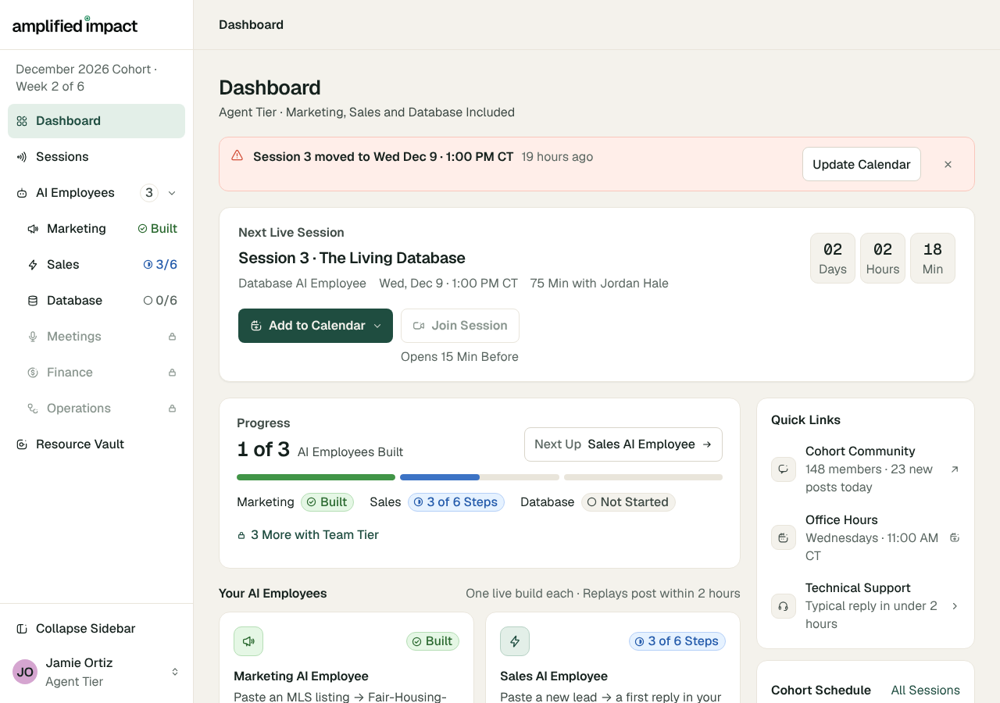 | 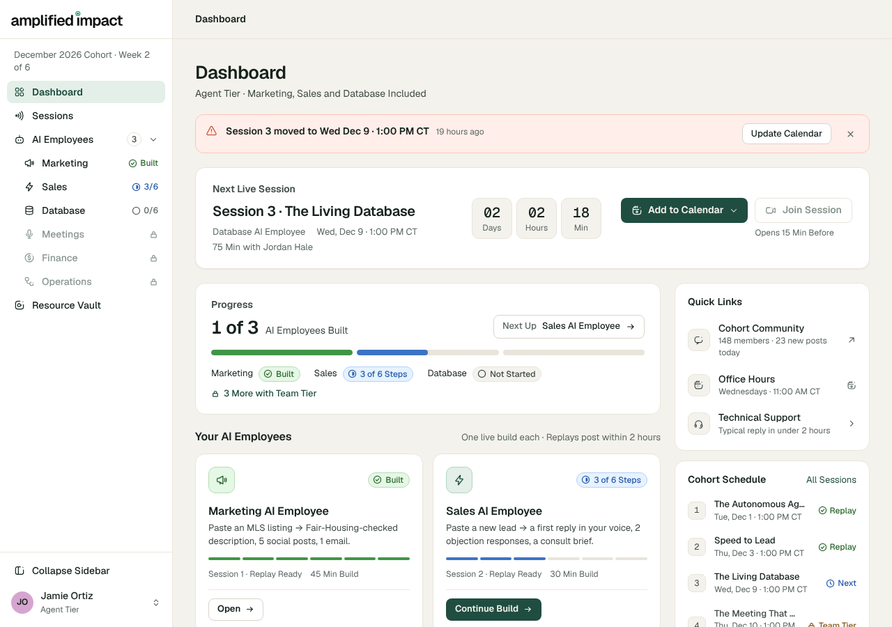 | 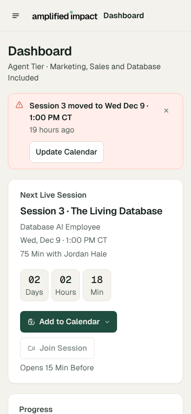 |  |
| Team Hub (owner) | 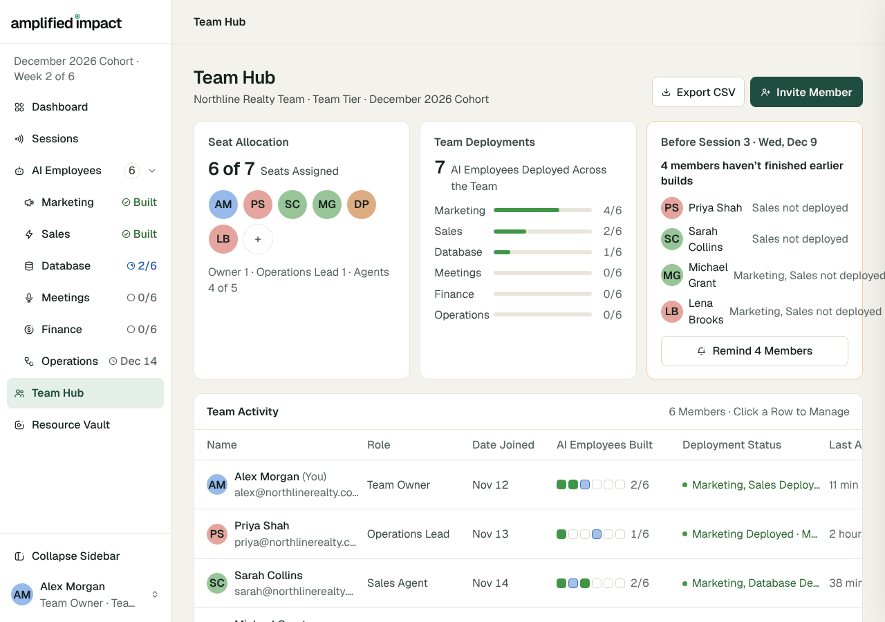 | 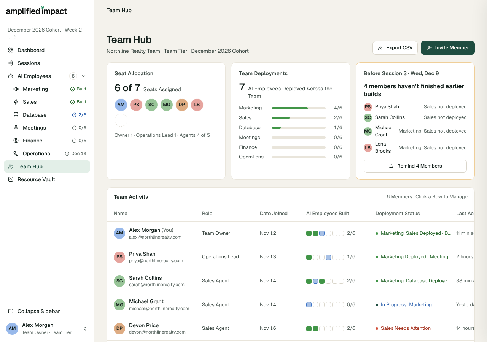 |  | 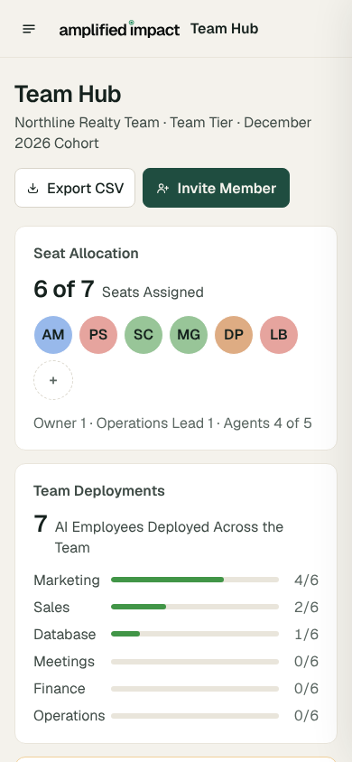 |
| Admin overview | 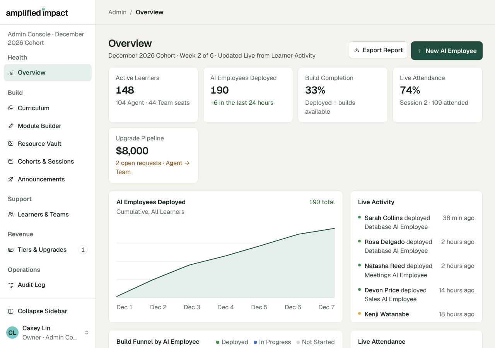 | 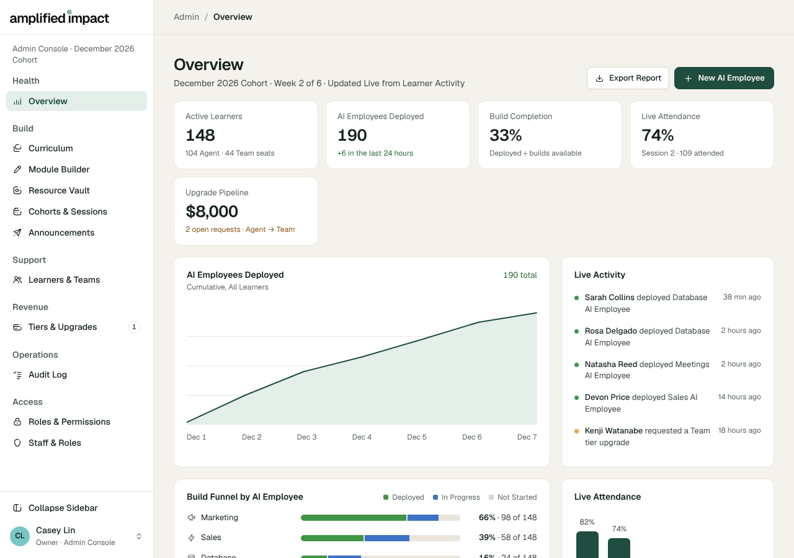 |  | 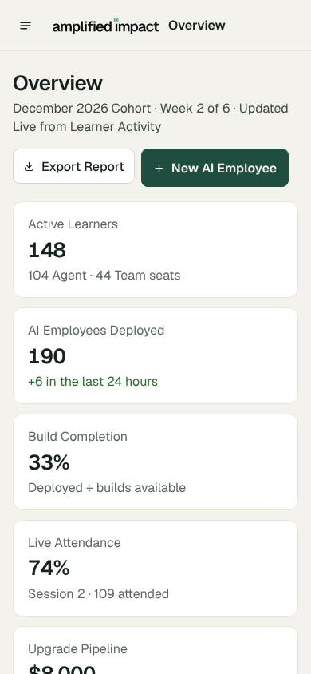 |
| Admin curriculum | 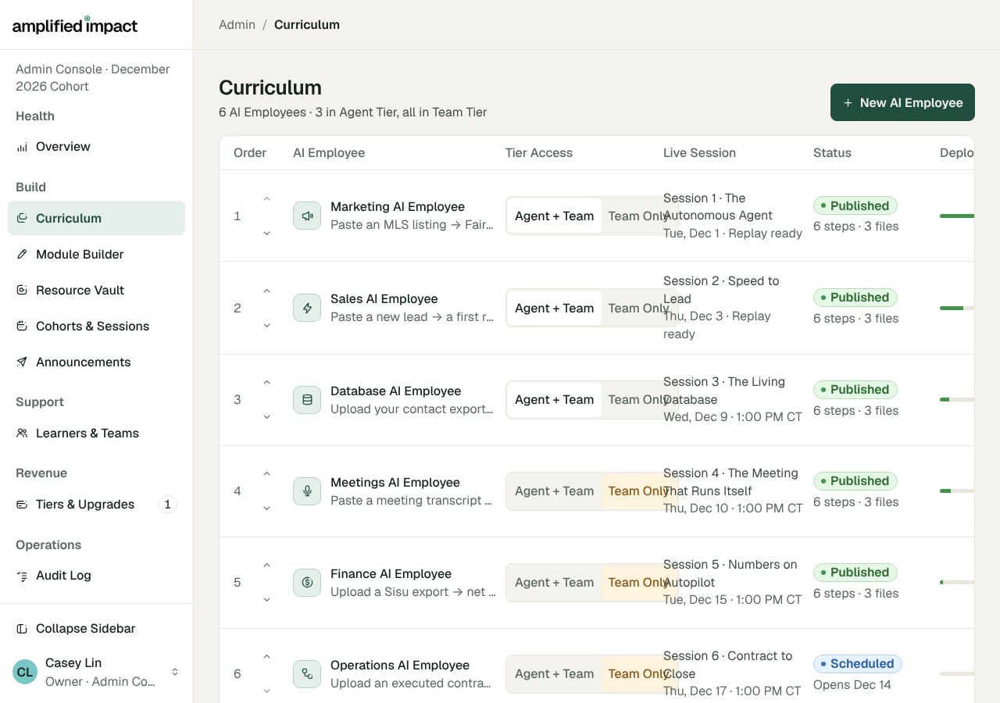 | 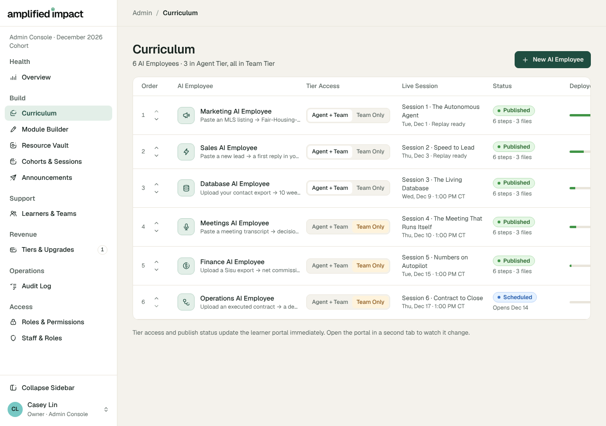 | 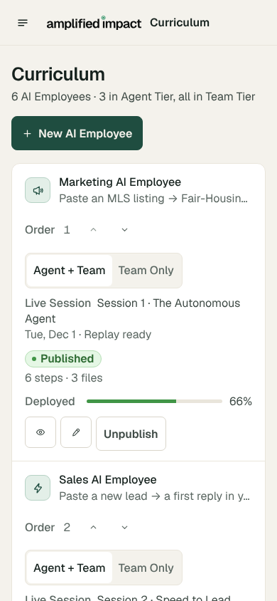 |  |

## Goldens, 1440 (reference renders from the pinned container)

| Scenario | before (R2-0) | after (this branch) |
|---|---|---|
| `dash-agent-live` page | 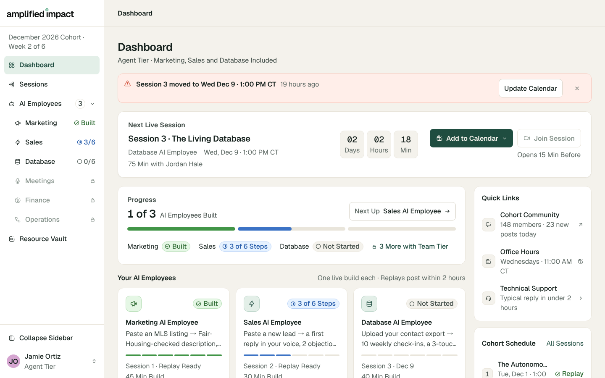 | 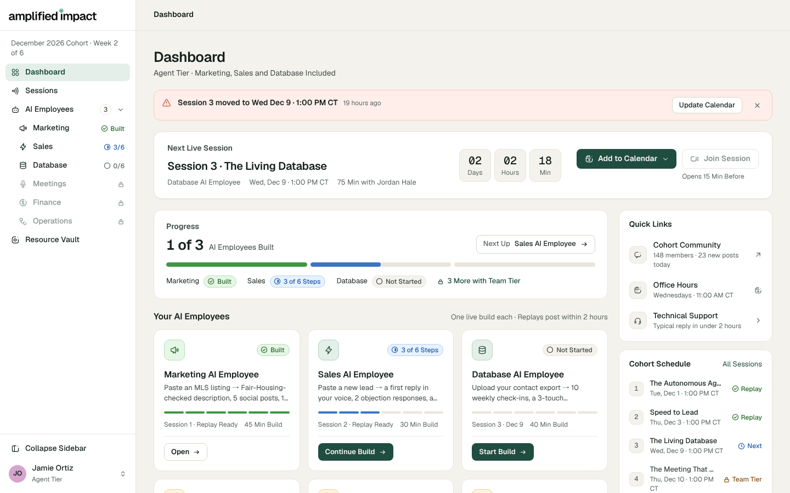 |
| `admin-overview` page | 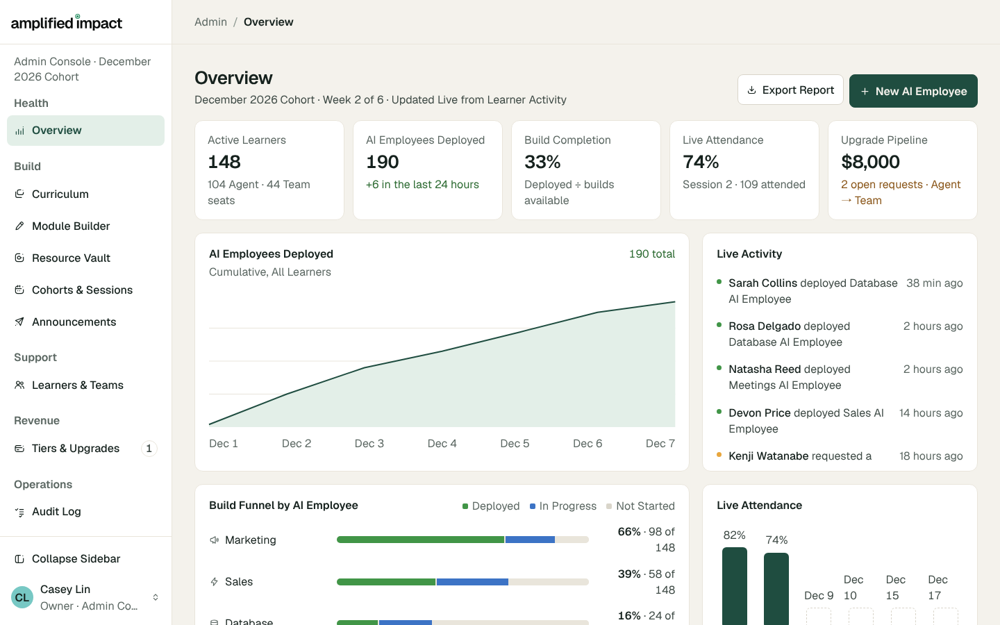 | 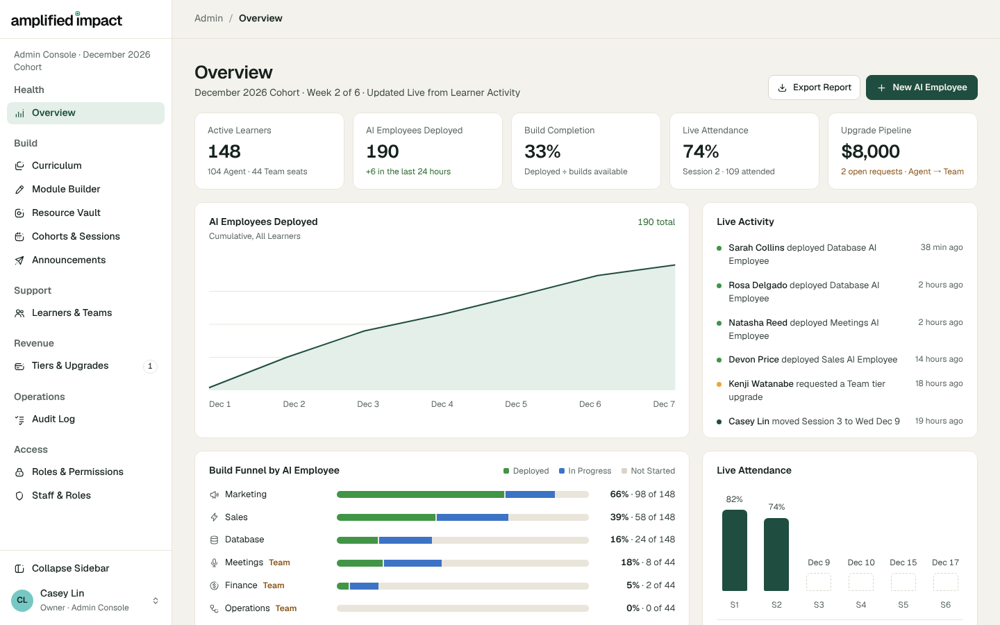 |
