# Admin Console 1b (D-157): Roles, Denied, the Console 404 and the shared states

From the fixture build, with `?as=admin` (Casey Lin, the prototype's fictional Owner): fixture data only, no real accounts. 390 and 1280 for every screen and state in this PR. Denied is the fixture's `?console-role=Support`; the loading, error and 429 states are its `?console-state=` switches, which the http build does not contain. JPEG at 1x; pages grown to their full scroll height. These files live only in this commit; the next commit removes them.

### console-404

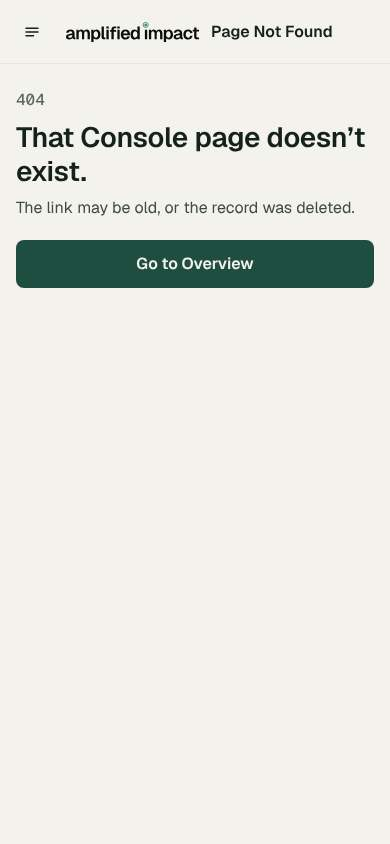 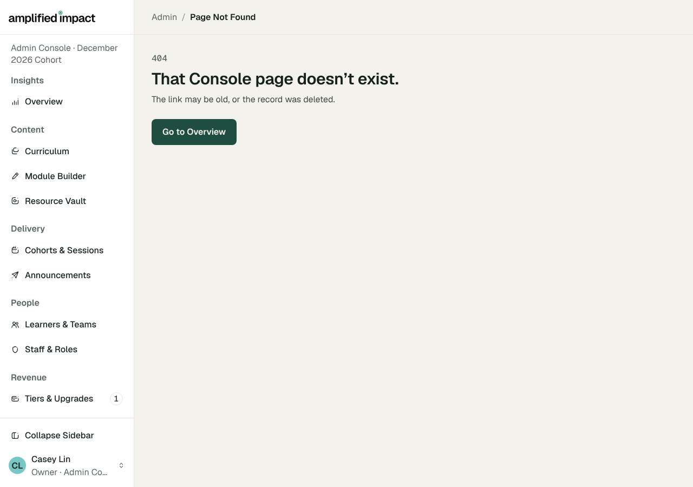

### console-roles

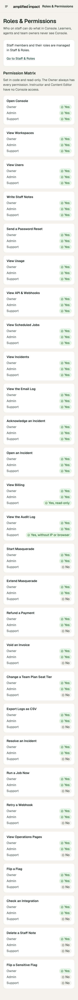 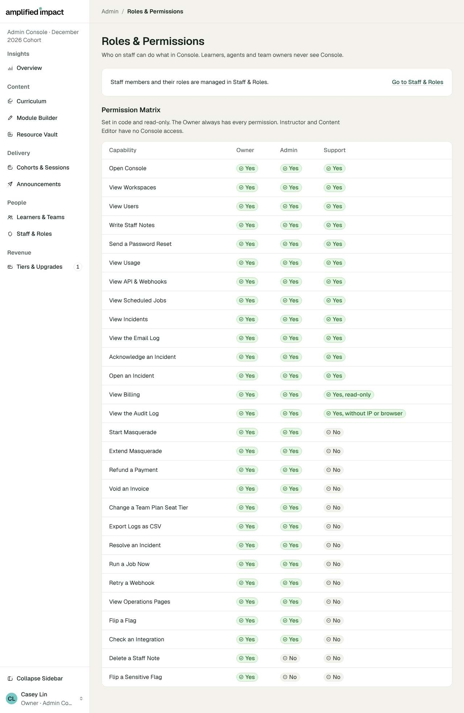

### console-roles-dark

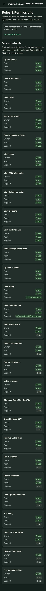 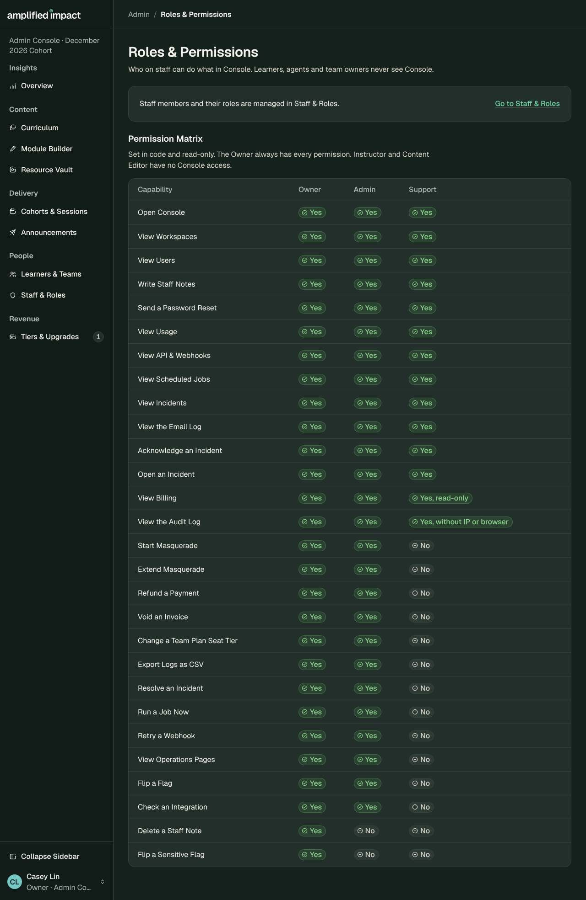

### console-roles-denied-support

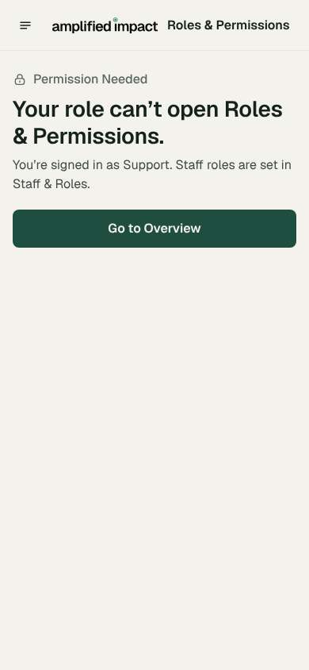 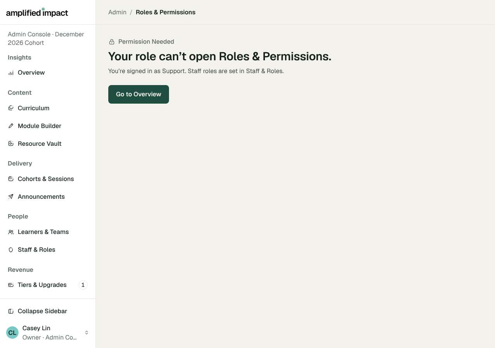

### console-state-429

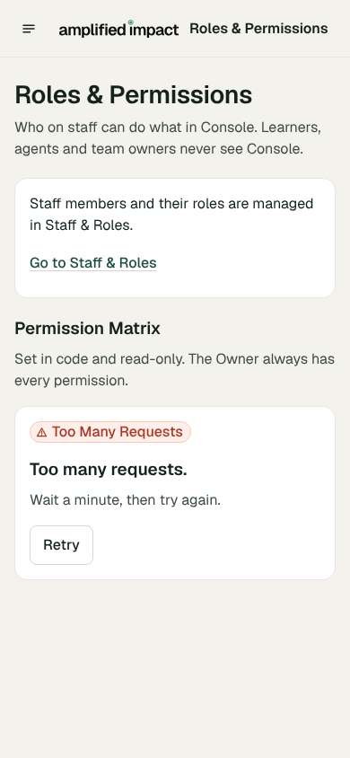 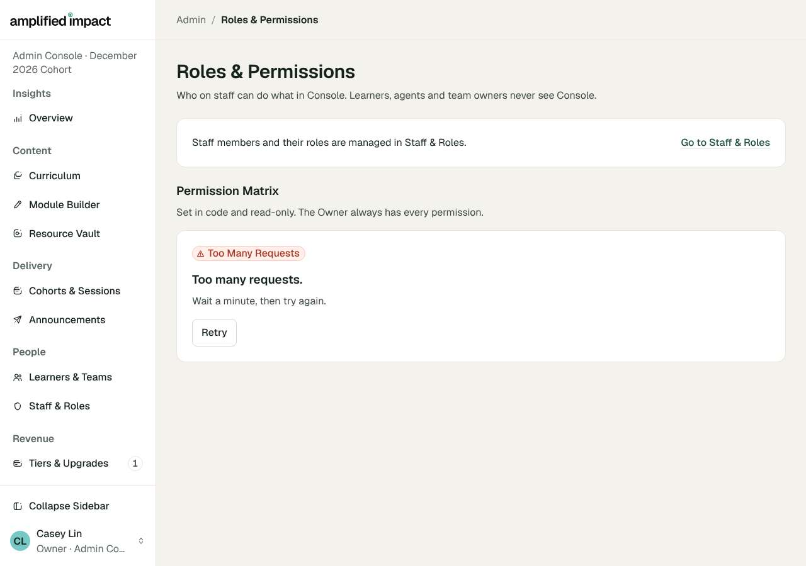

### console-state-error

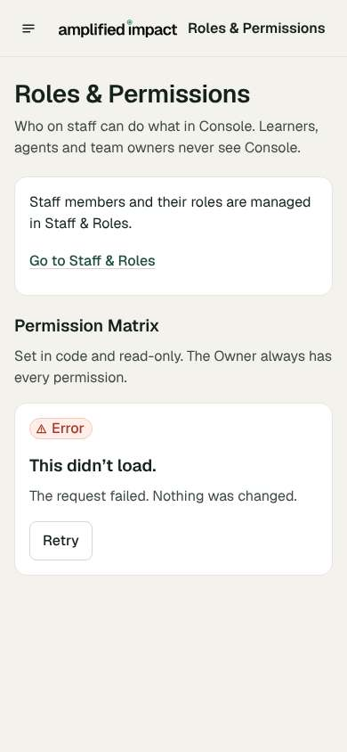 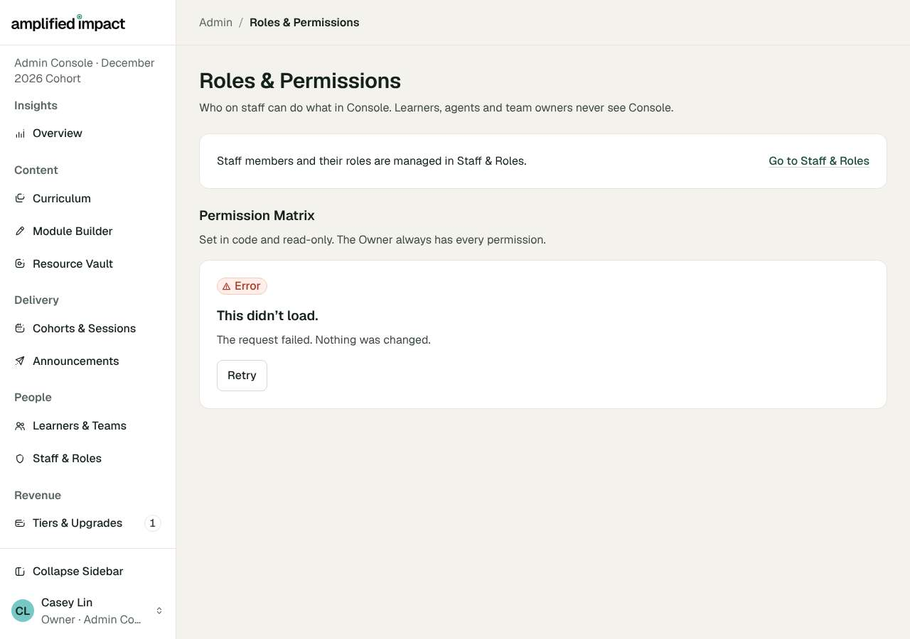

### console-state-loading

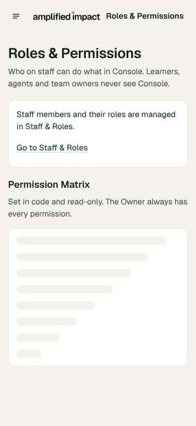 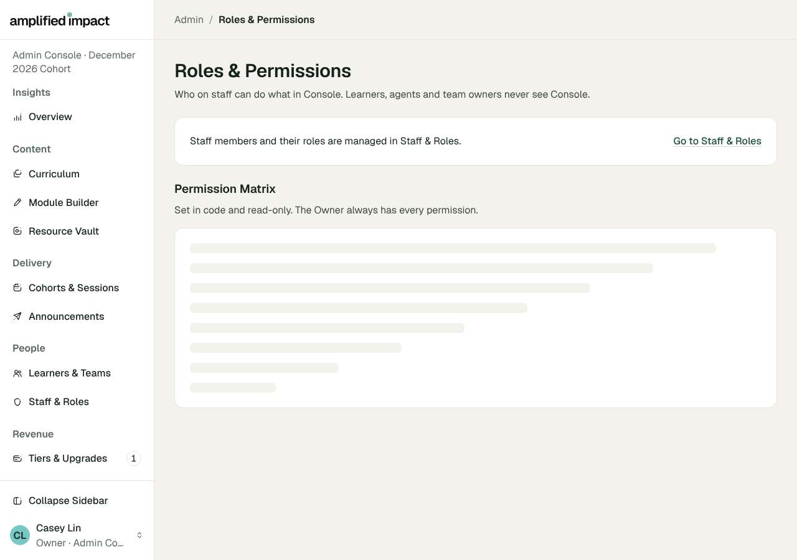
