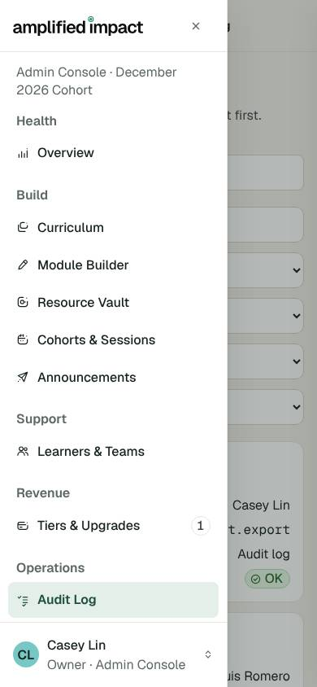
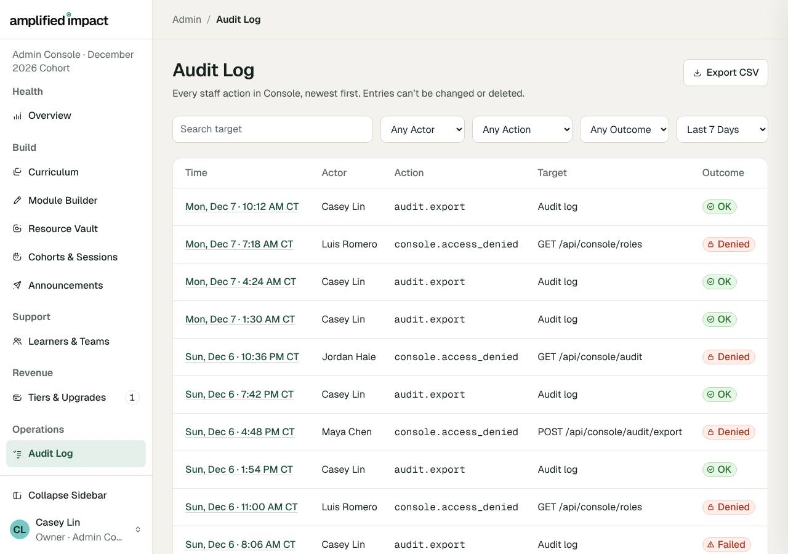
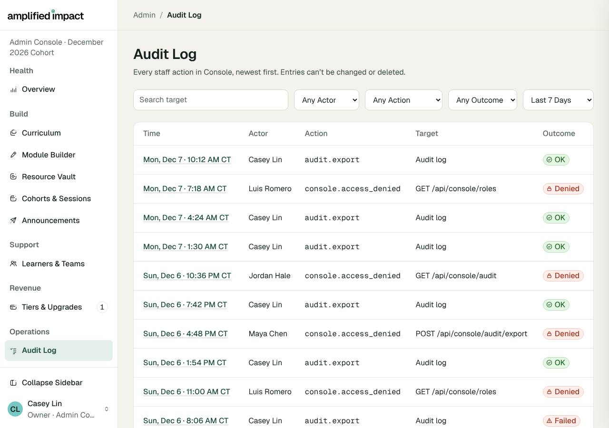
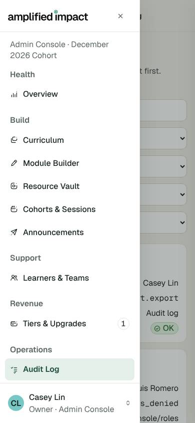
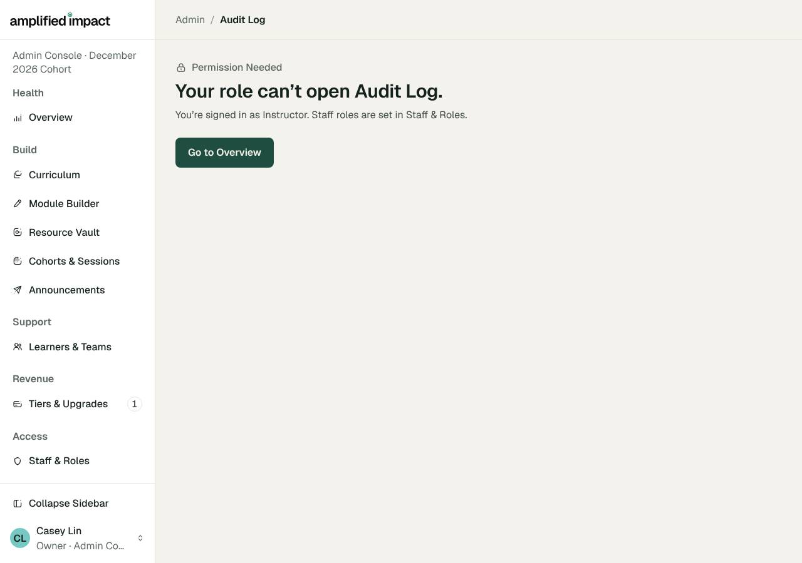
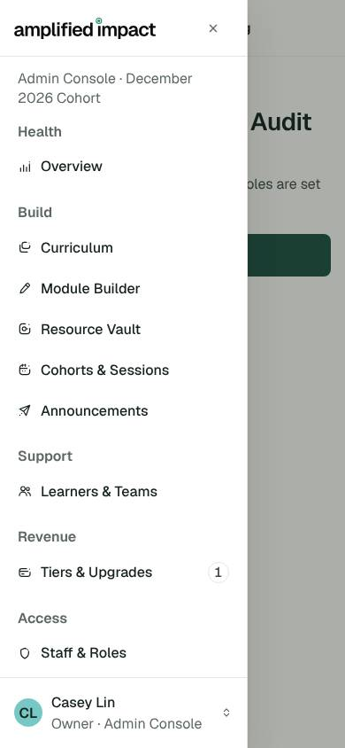
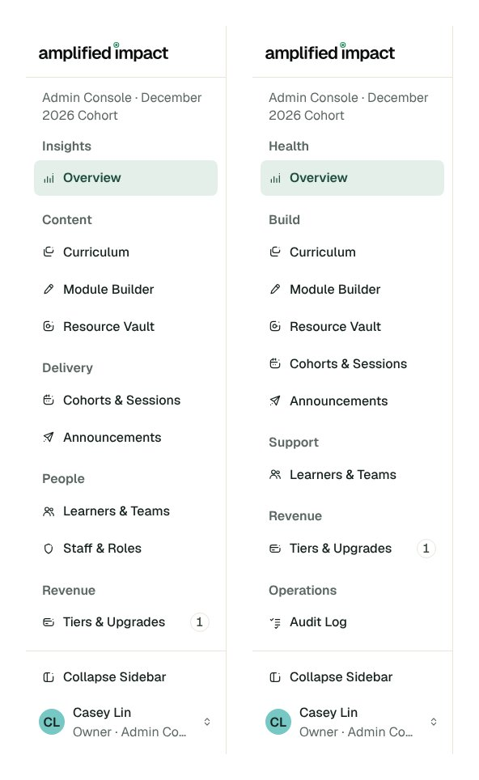

# Admin Console 1d (D-157): the grouped admin sidebar

From the fixture build on `/admin/audit`, with `?as=admin` and the fixture-only `?console-role=` preview: the prototype's fictional staff, no real accounts. The sidebar at 1280 and the phone drawer open at 390, for the Owner, an Admin, Support and an Instructor (no Console rows). Then the `shell-admin` sidebar golden before (left, `da2f768`) and after (right, this PR), both captured from `design-reference/` in the pinned container. At 900px tall the new sidebar scrolls: the Access group (Roles & Permissions, Staff & Roles) is below the fold in the golden and on a 900px screen, and reached by scrolling the nav or by Tab. JPEG at 1x. These files live only in this commit; the next commit removes them.

### Owner

 

### Admin

 

### Support

 

### Instructor

 

### The `shell-admin` sidebar golden, old and new

