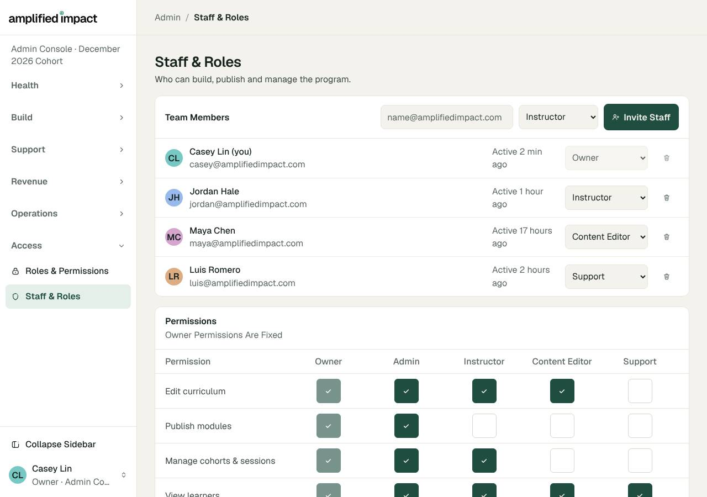
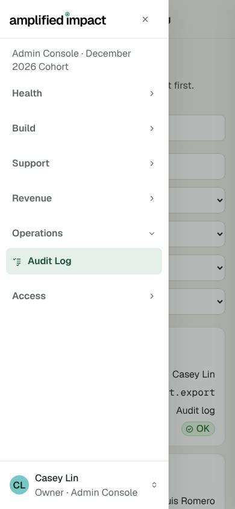
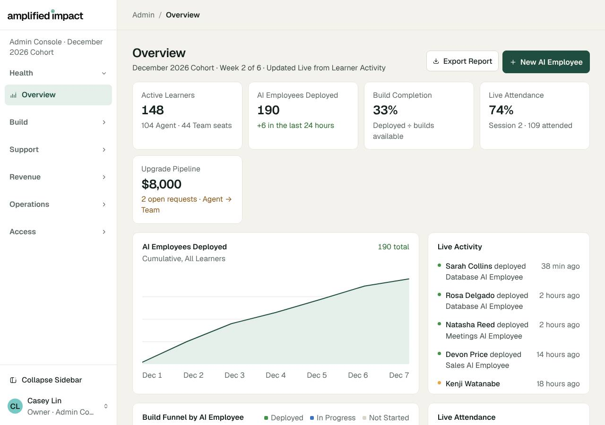
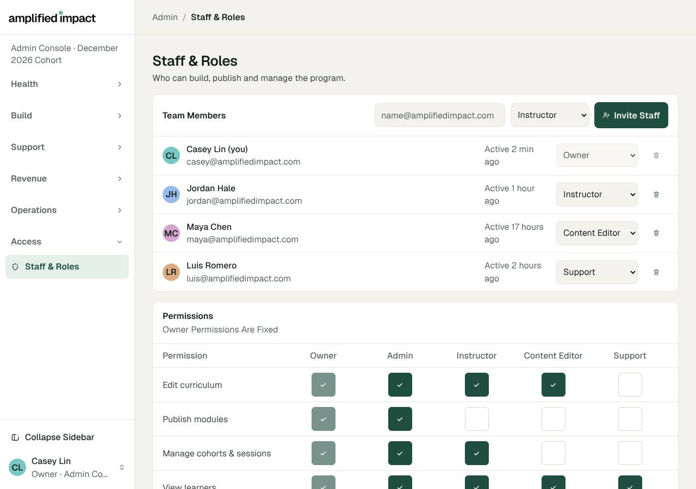
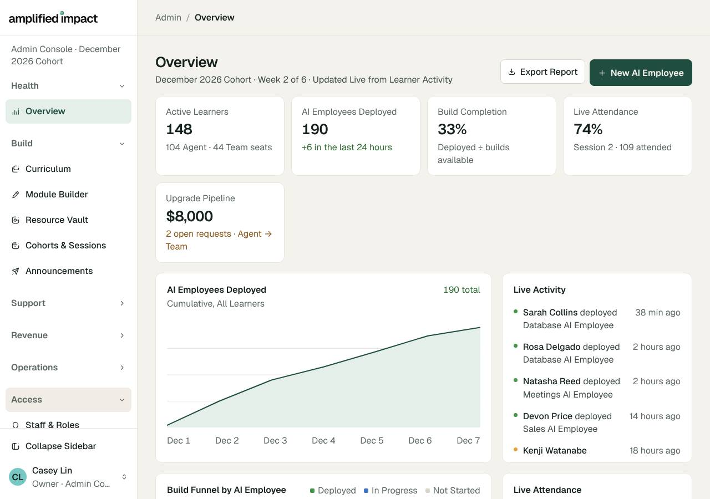
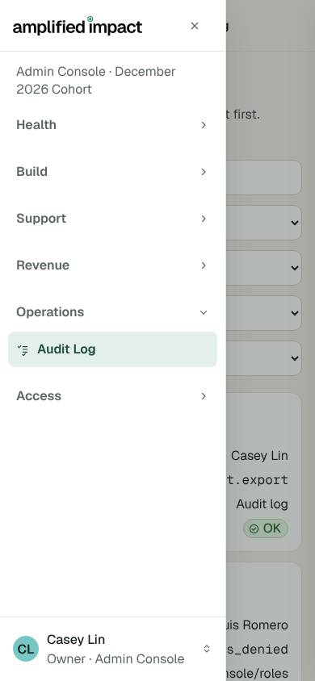
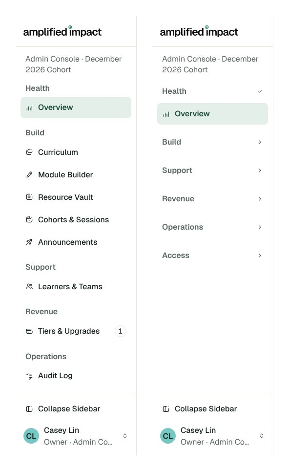

# Admin Console: collapsible sidebar groups (D-157)

From the fixture build with `?as=admin` (Casey Lin, the prototype's fictional Owner) and the fixture-only `?console-role=` preview for Support. Fixture data only, no real accounts. 1280×900 viewport (no scroll): the default state on Overview and on Staff & Roles, then Overview with Build and Access opened. 390: the phone drawer open on the Audit Log. Last, the `shell-admin` sidebar golden before (left, `ba0cb42`) and after (right). JPEG at 1x. These files live only in this commit; the next commit removes them.

### Owner

 

 

### Support

 

 

### The `shell-admin` sidebar golden, old and new

